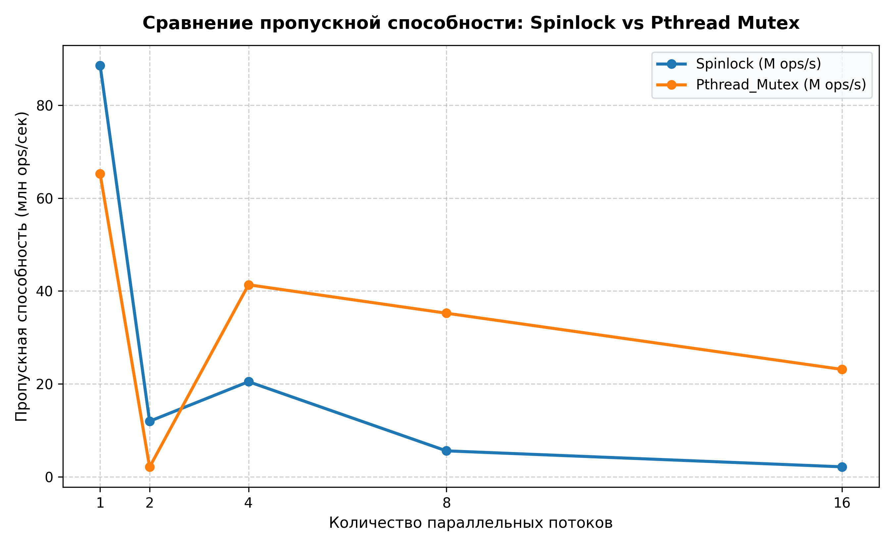
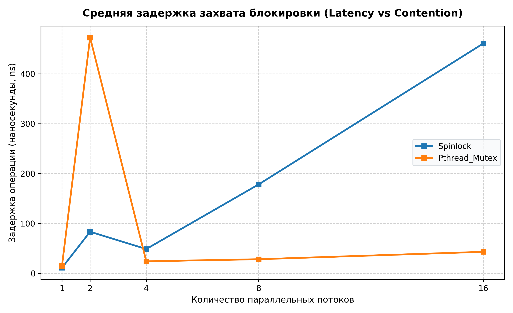
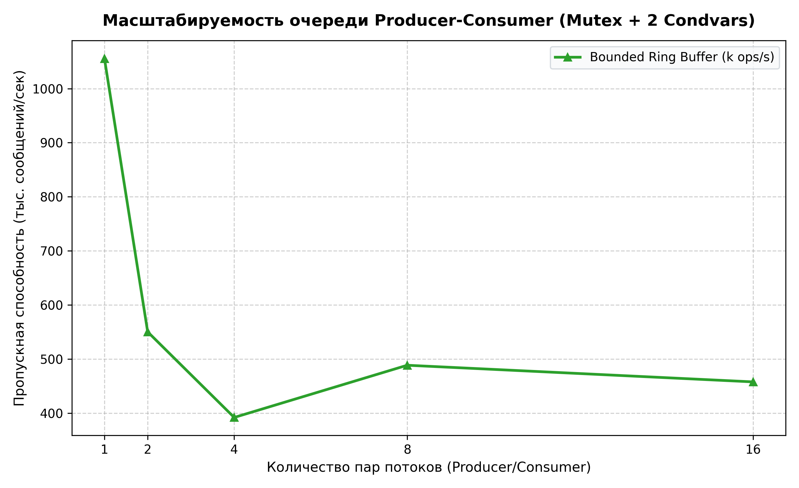

# Synchronization of Parallel Processes in Linux: POSIX Primitives, Futexes & Lock-Free Data Structures

[](https://cs110.stanford.edu)
[](https://github.com/sh1rotori/lab4-sync-parallel-processes/actions/workflows/ci.yml)
[](https://ubuntu.com/)
[](https://en.cppreference.com/)
[]()
[](LICENSE)

Исследовательский проект по параллельным вычислениям и архитектуре операционных систем в стиле курсов **Stanford CS Systems Engineering** (CS110 «Principles of Computer Systems», CS140 «Operating Systems»).

Проект посвящен углубленному проектированию, системному анализу и экспериментальному профилированию фундаментальных примитивов синхронизации многопоточных систем: мьютексов POSIX (`pthread_mutex_t`), условных переменных с Mesa-семантикой (`pthread_cond_t`), пользовательских спинлоков (`atomic_flag` + x86 `PAUSE`), справедливых протоколов читателей-писателей, иерархического устранения дедлоков по Дейкстре, а также lock-free структур данных (Michael-Scott Queue, Treiber Stack) с формальным разрешением феномена ABA посредством тегированных указателей (Double-Word CAS / Tagged Pointers).

---

## 📑 Содержание

1. [Архитектура и структура проекта](#-архитектура-и-структура-проекта)
2. [Системные требования и сборка](#-системные-требования-и-сборка)
3. [Описание модулей и практических экспериментов](#-описание-модулей-и-практических-экспериментов)
   - [3.1 Producer-Consumer (Гонка данных vs Мьютекс + 2 Condvars)](#31-producer-consumer)
   - [3.2 Readers-Writers (Приоритет читателей vs Приоритет писателей)](#32-readers-writers)
   - [3.3 Dining Philosophers (Устранение дедлока по Дейкстре)](#33-dining-philosophers)
   - [3.4 Spinlock vs Pthread Mutex (Бенчмарк contention)](#34-spinlock-vs-pthread-mutex)
   - [3.5 Lock-Free Michael-Scott Queue и Проблема ABA](#35-lock-free-ms-queue-и-проблема-aba)
4. [Автоматизированный бенчмаркинг и визуализация](#-автоматизированный-бенчмаркинг-и-визуализация)
5. [Теоретический базис и системная архитектура (Systems Architecture FAQ)](#-теоретический-базис-и-системная-архитектура-systems-architecture-faq)

---

## 📁 Архитектура и структура проекта

```text
lab4_sync/
├── .github/
│   └── workflows/ci.yml     # Автоматизированный CI: сборка под Ubuntu 22.04 LTS и стресс-тесты
├── Makefile                 # Автоматизация сборки со строгими флагами (-Wall -Wextra -Werror -pedantic)
├── LICENSE                  # Официальная лицензия MIT
├── README.md                # Архитектурное руководство и системный анализ примитивов синхронизации
├── src/
│   ├── common/
│   │   ├── timer.h          # Высокоточный замер времени через clock_gettime(CLOCK_MONOTONIC)
│   │   └── cli_parser.h/.c  # Парсер аргументов командной строки (--threads, --buffer, --items, --no-sync)
│   ├── prod_cons/
│   │   ├── buffer.h/.c      # Кольцевой буфер ограниченной емкости (Bounded FIFO Ring Buffer)
│   │   ├── prod_cons_naive.c# Демонстрация Data Race, потери счетчика (Lost Updates) и torn reads/writes
│   │   └── prod_cons_sync.c # Монитор с одним Mutex и 2 условными переменными Mesa (cond_not_empty, cond_not_full)
│   ├── readers_writers/
│   │   ├── rw_readers_pref.c# Читатели-писатели: приоритет читателей и воспроизведение голодания (Starvation)
│   │   └── rw_writers_pref.c# Читатели-писатели: приоритет писателей со справедливым распределением ресурсов
│   ├── philosophers/
│   │   └── philosophers.c   # Обедающие философы: математическое разрушение кругового ожидания Дейкстры
│   ├── spinlock/
│   │   ├── spinlock.h       # Пользовательский Spinlock на C11/C++ atomic_flag с cpu_relax() / pause
│   │   └── spinlock_test.c  # Сравнение накладных расходов: Spinlock vs Futex-based pthread_mutex_t
│   └── lockfree/
│       ├── ms_queue.hpp     # Lock-Free FIFO очередь Michael-Scott (1996) с механизмом Helping
│       └── aba_demo.cpp     # Воспроизведение проблемы ABA на стеке Трайбера и решение через Tagged Pointer
├── scripts/
│   ├── run_demo.sh          # Интерактивное консольное меню сценариев и нагрузочных тестов
│   └── benchmark.py         # Нагрузочное тестирование (1, 2, 4, 8, 16 потоков), выгрузка в CSV и отрисовка графиков
├── results/
│   ├── data.csv             # Таблица замеров пропускной способности (ops/sec) и задержки (ns)
│   └── plots/               # Графика: throughput.png, latency.png, contention.png
└── docs/
    ├── report.md            # Развернутый академический отчет и системный анализ (15+ страниц)
    ├── presentation.md      # Материалы презентации проекта (10 слайдов)
    └── theoretical_foundations.md # Монография: теоретический базис параллельных систем в Linux
```

---

## 🛠 Системные требования и сборка

### Требования к окружению:
- **ОС:** Linux (Ubuntu 22.04 LTS / 24.04 LTS) или совместимое POSIX-окружение
- **Компиляторы:** GCC 11+ / G++ 11+ (стандарты `-std=c11`, `-std=c++17`)
- **Утилиты:** GNU Make, Python 3.8+ (библиотека `matplotlib` для построения графиков)

### Быстрая сборка и запуск:

```bash
# 1. Переход в директорию проекта
cd lab4_sync

# 2. Сборка всех 7 бинарников со строгими проверками (-Werror)
make all

# 3. Интерактивный запуск меню демонстратора
make demo

# 4. Запуск автоматического сквозного теста всех сценариев
make run-all

# 5. Очистка объектных файлов и исполняемых программ
make clean
```

---

## 🔬 Описание модулей и практических экспериментов

### 3.1 Producer-Consumer
- **`prod_cons_naive`**: Потоки обращаются к кольцевому буферу без примитивов синхронизации. Возникают разрывы чтения/записи (torn reads/writes), сбой контрольных сумм элементов и потеря обновлений счетчика (`lost updates`).
  ```bash
  ./bin/prod_cons_naive --threads 4 --buffer 16 --items 25000
  ```
- **`prod_cons_sync`**: Используется один `pthread_mutex_t` и две условные переменные (`cond_not_empty`, `cond_not_full`).
  - Проверка условий в цикле `while` исключает уязвимость к ложным пробуждениям (Spurious Wakeups).
  - Раздельные condvar устраняют эффект громоподобного стада (Thundering Herd Problem).
  ```bash
  ./bin/prod_cons_sync --threads 4 --buffer 16 --items 100000
  ```

### 3.2 Readers-Writers
- **`rw_readers_pref`**: Читатели беспрепятственно входят в секцию, удерживая `read_count > 0`. Писатель голодает (Starvation), время задержки возрастает на порядки.
  ```bash
  ./bin/rw_readers_pref --threads 4
  ```
- **`rw_writers_pref`**: Появление ждущего писателя (`waiting_writers > 0`) блокирует доступ новым читателям. Писатель получает ресурс сразу после завершения текущих активных читателей.
  ```bash
  ./bin/rw_writers_pref --threads 4
  ```

### 3.3 Dining Philosophers
- **`philosophers`**: Решение взаимной блокировки по алгоритму Дейкстры.
  - Каждой вилке присвоен уникальный глобальный идентификатор $0 \le i < N$.
  - Каждый философ захватывает первой вилку $\min(left, right)$, а второй — $\max(left, right)$.
  - Это разрушает 4-е условие Коффмана (Круговое ожидание / Circular Wait).
  ```bash
  ./bin/philosophers --threads 5 --items 1000
  ```

### 3.4 Spinlock vs Pthread Mutex
- **`spinlock_test`**: Пользовательский спинлок на `atomic_flag` с инструкцией `cpu_relax()` (`pause` на x86) сравнивается с `pthread_mutex_t`.
  - При 1 потоке Spinlock превосходит Mutex благодаря отсутствию накладных расходов.
  - При 8–16 потоках активный спин вызывает "cache bouncing" и деградацию шины памяти, тогда как Futex усыпляет потоки в ядре.
  ```bash
  ./bin/spinlock_test --threads 8 --items 100000
  ```

### 3.5 Lock-Free MS-Queue и Проблема ABA
- **`aba_demo`**: 
  - Демонстрирует ложный успех `CAS` на вершине стека Трайбера после скрытой подмены промежуточного узла ($A \to B \to A$).
  - Показывает устранение проблемы через 64-битный тегированный указатель (`Tagged Pointer` / Generation Counter).
  - Тестирует lock-free очередь Michael-Scott на 50 000 операций с гарантией сохранения FIFO порядка.
  ```bash
  ./bin/aba_demo
  ```

---

## 📊 Автоматизированный бенчмаркинг и визуализация

Для запуска серии экспериментов на 1, 2, 4, 8 и 16 потоках выполните:

```bash
python3 scripts/benchmark.py
```

Результаты замеров сохраняются в `results/data.csv` и визуализируются в виде аналитических графиков:

### 4.1 Масштабирование пропускной способности (Throughput Scaling)

<p align="center">
  
</p>

- **Системный анализ:** В диапазоне 1–4 потоков пропускная способность примитивов демонстрирует стабильный прирост. При превышении числа физических ядер (8–16 потоков) наступает насыщение: накладные расходы на арбитраж шины памяти и диспетчеризацию планировщика CFS начинают преобладать над полезной работой в критических секциях.

### 4.2 Задержка захвата и деградация при конкуренции (Latency & Contention)

<p align="center">
  
</p>

- **Системный анализ:** 
  - **Низкий Contention (1–2 потока):** Пользовательский Spinlock (`atomic_flag` + x86 `PAUSE`) превосходит `pthread_mutex_t` благодаря отсутствию системных вызовов и мгновенному захвату в Ring 3.
  - **Высокий Contention (8–16 потоков):** Задержка Spinlock лавинообразно возрастает из-за непрерывного межъядерного шторма инвалидации кэш-линий (*cache-line bouncing*, протоколы MESI/MOESI). В свою очередь, двухфазный **Linux Futex** (`pthread_mutex_t`) демонстрирует стабильную кривую: потоки, не получившие блокировку на fast-path, усыпляются ядром через `sys_futex(FUTEX_WAIT)`, предотвращая бесполезное сжигание процессорных тактов.

### 4.3 Масштабирование очереди Producer-Consumer при росте нагрузки

<p align="center">
  
</p>

- **Системный анализ:** Синхронизированная очередь на базе `pthread_mutex_t` и двух условных переменных гарантирует строгую целостность инвариантов (0 повреждений памяти и torn reads). Однако при росте числа конкурирующих производителей и потребителей время ожидания освобождения кольцевого буфера монотонно растет из-за последовательной сериализации доступа, что иллюстрирует закон Амдала и мотивирует переход к lock-free алгоритмам (Michael-Scott Queue) в ультра-низколатентных системах.

---

## 🏛️ Теоретический базис и системная архитектура (Systems Architecture FAQ)

| Инвариант / Архитектурная проблема (Design Challenge) | Механика ядра Linux и системный анализ (Kernel Mechanics & Invariants) |
|:---|:---|
| **Семантика предикатов ожидания: почему `while`, а не `if` при `pthread_cond_wait`?** | 1. **Mesa Monitor Semantics:** вызов `pthread_cond_signal` не передает управление пробуждаемому потоку немедленно, а лишь переводит его из очереди ожидания в очередь планировщика на захват мьютекса. К моменту фактического захвата ресурс может быть перехвачен другим потоком.<br>2. **Spurious Wakeups (Ложные пробуждения):** на уровне ядра системный вызов `sys_futex(..., FUTEX_WAIT, ...)` может быть прерван доставкой сигнала ОС (`EINTR`) или оптимизациями SMP-планировщика, возвращая поток в user-space до наступления целевого события. |
| **Атомарность `pthread_cond_wait(&cond, &mutex)` и предотвращение Lost Wakeup** | Вызов **атомарно** освобождает связанный мьютекс и ставит вызывающий поток в очередь ожидания futex в ядре. Если бы эти действия выполнялись неатомарно, сигнал мог бы быть доставлен в микросекундное окно между разблокировкой и засыпанием (**Lost Wakeup**), приводя к вечному зависанию. При выходе из ожидания поток атомарно конкурирует за повторный захват мьютекса. |
| **Инварианты взаимной блокировки (Deadlock) и условия Коффмана** | Возникновение дедлока требует одновременного выполнения всех 4 условий Коффмана:<br>1. **Mutual Exclusion** — неразделяемое владение ресурсом.<br>2. **Hold and Wait** — удержание одного ресурса при ожидании доступа к следующему.<br>3. **No Preemption** — невозможность принудительного отчуждения ресурса у активного потока.<br>4. **Circular Wait** — замкнутая цепочка ожидания ($T_0 \to T_1 \to \dots \to T_n \to T_0$). |
| **Математическое разрушение кругового ожидания по Дейкстре (Resource Ordering)** | Введение строгого глобального порядка ресурсов ($R_0 < R_1 < \dots < R_{N-1}$) и протокол монотонного захвата $\min(id_1, id_2) \to \max(id_1, id_2)$. Это трансформирует граф распределения ресурсов (Resource Allocation Graph) в направленный ациклический граф (**DAG**), математически исключая возможность образования циклов и устраняя **Circular Wait**. |
| **Микроархитектурные эффекты Spinlock и инструкция `PAUSE` (`cpu_relax`)** | Инструкция `pause` на x86/x86_64:<br>1. Предотвращает конвейерную деградацию процессора (**Memory Order Violation Pipeline Flush**) при выходе из цикла опроса флага;<br>2. Разгружает межъядерную шину когерентности кэшей (**MESI / MOESI**), сокращая частоту инвалидации L1/L2 кэш-линий (**cache bouncing**);<br>3. Снижает энергопотребление процессорного ядра во время фазы активного ожидания. |
| **Двухуровневая архитектура Fast User-Space Mutex (`sys_futex`)** | 1. **Uncontended Fast-Path (Ring 3):** захват выполняется атомарной процессорной инструкцией CAS (`lock cmpxchg`) в пространстве пользователя без системного вызова и без переключения контекста (~10–25 нс).<br>2. **Contended Slow-Path (Ring 0):** при наличии конкуренции поток выполняет `sys_futex(val, FUTEX_WAIT_PRIVATE)`, и ядро усыпляет поток в очереди ожидания планировщика CFS. |
| **Феномен ABA в структурах Lock-Free и решение через Tagged Pointers** | 1. **Проблема ABA:** ячейка меняет значение $A \to B \to A$. Обычный CAS проверяет только битовое совпадение адреса и ложно фиксирует неизменность состояния, хотя промежуточные узлы были удалены или перераспределены в памяти.<br>2. **Решение (Tagged Pointer):** связывание указателя с 64-битным монотонным счетчиком версий/поколений. 128-битный атомарный CAS (**DWCAS** / `CMPXCHG16B`) проверяет кортеж `(Pointer, Version)`. Так как $(A, v_1) \neq (A, v_2)$, несанкционированная подмена отклоняется. |
| **Иерархия неблокирующих гарантий (Non-Blocking Progress Guarantees)** | 1. **Obstruction-Free:** гарантирует прогресс потока только при отсутствии конкуренции со стороны других потоков.<br>2. **Lock-Free:** общесистемная гарантия прогресса (System-wide progress) — как минимум один поток гарантированно завершает шаг за конечное число операций, даже если отдельные потоки голодают.<br>3. **Wait-Free:** строгая индивидуальная гарантия (Per-thread progress) — каждый поток завершает операцию за конечное детерминированное число шагов ($O(1)$ или $O(k)$). |
| **Протоколы Readers-Writers: компромисс между пропускной способностью и голоданием** | В протоколе **Readers-Preference** операции чтения имеют минимальную задержку, но непрерывный поток читателей вызывает полное истощение ресурсов (**Writer Starvation**). Протокол **Writers-Preference** блокирует новых читателей при наличии ожидающего писателя, стабилизируя задержку записи и предотвращая starvation в системах с критическими обновлениями состояния. |
